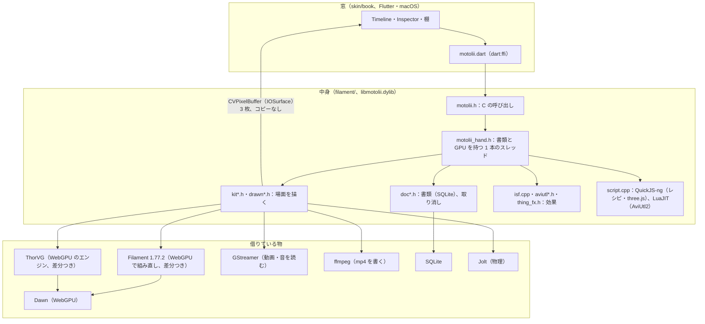

# 作り（Architecture）

*How Motolii is built, for someone about to read or change the code. A Flutter window drives a C++ engine through a small C API (`filament/motolii.h`). One engine thread owns the document (SQLite) and the GPU: Filament, built from source with its WebGPU (Dawn) backend and a few patches, draws the 3D scene and composites; ThorVG's WebGPU engine draws 2D and text on the same Dawn device; GStreamer reads films and ffmpeg writes them. Shared effects are compiled to WGSL with the toolchain Filament already ships (glslang → SPIR-V → Tint). The finished picture reaches the window without a copy through IOSurface-backed CVPixelBuffers.*

## 全体

## 境目

| 境目 | どこ | 決まり |
|---|---|---|
| 窓 → 中身 | `filament/motolii.h`（約 230 行）、Dart 側は `skin/book/lib/motolii.dart` と ffigen が作る `motolii_bindings.dart` | 窓は値を持たない。読むのも変えるのも C の呼び出しで、書類が正（窓と中身の境目の決まりは [`skin/BRIDGE.md`](skin/BRIDGE.md)） |
| 中身の中 | `filament/motolii_hand.h` | 書類と GPU に触るのは 1 本のスレッドだけ。呼び出しはそのスレッドに頼んで待つ（`by_hand`） |
| 中身 → 窓（絵） | `filament/live.h` | 場面は IOSurface の上の CVPixelBuffer 3 枚に描き、それを Dawn のテクスチャとして Filament の描き先にする。窓（Flutter の外部テクスチャ、`skin/book/macos/Runner/MainFlutterWindow.swift`）は同じ物を読む |
| 借りた物 | `filament/dawn_probe/*.patch`、`filament/tsl/*.patch` | 人のコードは直接いじらず、版を固定して取ってきて差分を当てる（[`THIRD_PARTY_NOTICES.md`](THIRD_PARTY_NOTICES.md) の 2 節） |

## 描く

- **Filament** を v1.77.2 のソースから WebGPU（Dawn）の口で組む（`filament/dawn_probe/build.sh`）。配られている SDK には WebGPU が無いため。当てる差分：計算（compute）の口、Dawn の装置を外に貸す口、外のテクスチャを受ける `Texture::Builder::import`（`filament_dawn_compute.patch`）、AviUtl2 の HLSL のために glslang の HLSL の読み手を入れる（`glslang_hlsl.patch`）。
- **ThorVG** は WebGPU のエンジンを、Filament と同じ Dawn の装置の上で動かす（`filament/dawn_probe/tvg_on_dawn.sh`、`drawn.h`）。描いた絵は Filament の場面の中の板になる（切り抜き・ガラス越し・キーが効く）。
- 形の足し引きは **Skia** のパスの部分だけ（`filament/skia.sh`）、平らな形の三角形分けは **libtess2**。
- 画面の拍子は Thermion の FrameScheduler（CVDisplayLink、`filament/third_party/thermion_frame/`）。

## 効果の道

| 置く物 | 道 | どこ |
|---|---|---|
| ISF（`.fs`、GLSL） | glslang → SPIR-V → Tint → WGSL。Filament の組み立てに入っている物をそのまま使う | `filament/isf.cpp` |
| WGSL（`.wgsl`） | そのまま。頭に AviUtl2 式のつまみの行 | `filament/screen.h`、`thing_fx.h` |
| AviUtl2（`.anm2`・`.obj2`） | Lua は LuaJIT（AviUtl2 と同じ）で走らせ、`obj` の呼び出しを中身の物で受ける。中の HLSL は glslang の HLSL の読み手 → SPIR-V → Tint → WGSL | `filament/aviutl.cpp`、`aviutl_fx.h` |
| three.js の形（`solids/*.js`） | QuickJS-ng で three.js を動かし、BufferGeometry を受け取る | `filament/solid_three.cpp` |
| レシピ（`recipes/*.js`） | QuickJS-ng。1 回で物と値を作る | `filament/script.cpp` |
| TSL | three.js 自身の WGSLNodeBuilder を QuickJS で（道具、編集の棚にはまだ） | `filament/tsl/` |

## 書類

- 1 つの `.motolii` は SQLite のファイル。物・値・キー・キーの間の動き方（式、SQLite の関数 `bezier()`・`anime()`）を表に持つ（`filament/doc*.h`）。
- 取り消しは、変更を `step` の表に積む（`doc_match.h`）。
- 物の種類：film・picture・text・solid・shape・camera・light・behaviour（`edit.cpp` の `help`）。

## 動画・音・書き出し

- 動画は **GStreamer** が読み（何の形式でも、GStreamer が部品を選ぶ）、絵を板に貼る（`filament/video.h`、`gst_read.h`）。
- 作業中の音は GStreamer の playbin（`sound.h`）。
- 書き出しは、場面を 1 秒 60 枚描いて **ffmpeg** に渡し、物の音も ffmpeg で混ぜる（`filament/kit_draw.h` の `film`）。

## 言葉

| この repo の言葉 | ふつうの言い方 |
|---|---|
| 窓 | アプリの画面（UI、`skin/book`） |
| 中身 | エンジン（`filament/`、`libmotolii.dylib`） |
| 物 | レイヤー（場面に置いた 1 つ） |
| 場面・舞台・Stage | コンポジション（描かれる画面） |
| 書類 | プロジェクトファイル（`.motolii`） |
| 棚 | 効果・レシピなどの一覧（Create・Effects） |
| レシピ | 1 回で絵を作るスクリプト |
| 台帳 | `ASSETS.md`（在る物とどこまで確かめたか） |
| 手（hand） | 書類と GPU を持つスレッド |
