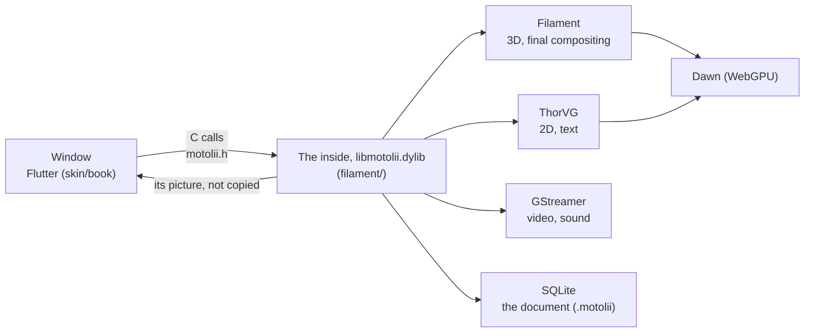

# Motolii

**Use a cool look you found on the net in your own video, right away — without waiting for a developer.**

Motolii is a macOS app for making music videos (picture-led motion graphics). Shader effects that people share online (ISF, WGSL) and AviUtl2 scripts work in your video **by dropping the file in**. 2D and 3D share one scene. It is under development; there is no release you can download yet.

[日本語](README.md)


*Eight ISF effects as their authors share them (CMYK Halftone, Bad TV, Duotone, Edges, Dither-Bayer, Kaleidoscope Tile, Glow-Fast, Pixellate) on a public-domain photo and text.*

## What it does today

| You can drop in | What it is | State |
|---|---|---|
| ISF effects (`.fs`) | The shader format VJ tools share ([ISF-Files](https://github.com/Vidvox/ISF-Files) and others) | Put one in the effects folder and it is on the shelf. 318 of ISF-Files' 327 run. 115 bundled |
| WGSL effects (`.wgsl`) | WebGPU shaders, e.g. three.js screen effects moved over | On the whole picture or on one thing. 18 bundled |
| AviUtl2 scripts (`.anm2`, `.obj2`) | Scripts for AviUtl2, a Japanese video editor; their HLSL is turned into WGSL | 172 packages bundled; the ones needing no Windows DLL first, partly |
| TSL (three.js shading language) | 48 TSL collections on the net, made WGSL by three.js's own compiler | Up to WGSL; not on the editor's shelves yet |
| Video, photos, text, shapes, glTF models, point clouds (`.ply`) | Media | Works (video: GStreamer, text and shapes: ThorVG, 3D: Filament) |
| After Effects exports (Lottie `.json`) | Animated pictures | Works (ThorVG) |
| MIDI (`.mid`) | Notes as parts of the scene: a piano roll, or keys set on values at each note | Works; it does not play sound yet |
| Your own scripts (`.js`) | Recipes that make a picture in one step, motions for things | Put one in and it is on the shelf. 44 recipes bundled |

Also: keyframes and easing (anime.js eases work as they are), physics (Jolt), refracting glass, writing mp4. Everything that exists and how far it was checked is in the author's ledger [`ASSETS.md`](ASSETS.md) (Japanese).

## How it differs

| | Motolii | After Effects | Cavalry | Alight Motion | Motion Canvas |
|---|---|---|---|---|---|
| Adding a new look | Drop in a shared file (ISF, WGSL, AviUtl2, JS) | Buy or write a plugin | Build it yourself | Wait for an app update | Write code |
| 2D and 3D | One scene (Filament) | 2D and 3D layers | Mostly 2D | Mostly 2D | 2D |
| How you work | A window; its handling follows Alight Motion | A window | A window | A phone | Code |
| Price, licence | Free, Apache-2.0 or MIT | Paid | Paid (free tier) | Paid (free tier) | Free, MIT |

## How it is built



The window only takes your hands; the inside draws. The inside's folder is named `filament/` for historical reasons — it is Motolii's engine, not Google's Filament (which is fetched at build time).

## Where it stands

- Works: everything marked "Works" above, saving and undo, playback, writing mp4, the window's timeline, inspector and shelves.
- Partly: AviUtl2 scripts; copying Alight Motion's handling (of 649 operations in the reference table, 14% behave the same and 63% are missing: [`reports/overview.md`](reports/overview.md)).
- Not yet: Windows; an `.app` you can hand out (the inside loads Homebrew's libraries, so a build only runs on the Mac that made it); some sound while working.

## Try it

### What you need

| | Version | Get it |
|---|---|---|
| Mac | Apple silicon (checked on macOS 15.5) | — |
| Xcode | Xcode from the App Store (the Command Line Tools alone cannot build the window) | App Store |
| Homebrew | — | [brew.sh](https://brew.sh/) |
| Flutter | 3.47.2 (stable) | [flutter.dev, macOS](https://docs.flutter.dev/get-started/install/macos), `flutter` on your PATH |
| Disk | About 10 GB (8.1 GB once built) | — |
| Time | About 10 minutes the first time on an M4 (Filament ~5, the inside ~1–2, the window ~1–3), plus downloads | — |

### Build and open

```bash
git clone https://github.com/oshikaidesu/motolii.git
```

```bash
cd motolii
```

```bash
brew bundle
```

```bash
filament/dawn_probe/build.sh
```

```bash
filament/edit.sh out/first.motolii < /dev/null
```

```bash
skin/book/live.sh
```

`brew bundle` installs what the `Brewfile` lists. `dawn_probe/build.sh` fetches and builds Filament with its WebGPU backend; `edit.sh` builds the inside, fetching ThorVG, Skia, libtess2 and Jolt the first time; `live.sh` opens the window.

### Your first piece (from the command line)

A recipe makes a picture, a glow goes on it, an RGB split (`rgbshift.wgsl`) goes on the whole picture, and 8 seconds are written as mp4. `filament/edit.sh` opens a document and takes one call per line (`help` lists them).

```bash
filament/edit.sh $HOME/Movies/first.motolii <<EOF
make Weave
effect 1 Glow
say 0 script $PWD/filament/effects/rgbshift.wgsl
write $HOME/Movies/first.mp4
EOF
```


### Reading the window

- Left: media and shelves (Create: recipes, shapes, text; Effects). Press a tile to put it in the scene.
- Middle: the stage (the inside's own picture); below it the timeline (a band per thing, its keys) and Ease (how values move between keys).
- Right: the inspector (the picked thing's values; drag across a number to change it). Render, top right, writes the video.
- Your own effects and recipes go in `~/Library/Application Support/Motolii/` (`effects/`, `recipes/`, `ways/`) and appear on the shelves at once.

### If something stops

| You see | Do |
|---|---|
| `flutter: command not found` | Put Flutter on your PATH (flutter.dev), or `FLUTTER=/path/to/flutter skin/book/live.sh` |
| `brew: command not found` | Install Homebrew with the one line on [brew.sh](https://brew.sh/) |
| `xcrun: error`, or Xcode missing | Install Xcode from the App Store and open it once to add its components |
| `ld: library 'webgpu_dawn' not found` | Run `filament/dawn_probe/build.sh` first |
| The window opens but the stage is black | Check the inside is built (`filament/out/libmotolii.dylib`); if not, `filament/edit.sh out/first.motolii < /dev/null` |

Still stuck? Open an [issue](https://github.com/oshikaidesu/motolii/issues) with the command you ran and what it printed. English is fine.

## Contributing

See [`CONTRIBUTING.md`](CONTRIBUTING.md) (building, running the tests, the rules, good first tasks). Issues and pull requests in English are welcome.

The project's stance: **code you write yourself is a debt.** Look for an existing implementation first and use it the way its author meant; bundle other people's work as unchanged as possible, with their licence and source beside it; keep changes to upstream code as patches applied at build time; say in each commit what was borrowed from where.

## Licence

Licensed under either of [Apache License 2.0](LICENSE-APACHE) or [MIT](LICENSE-MIT), at your option. Unless you explicitly state otherwise, any contribution intentionally submitted for inclusion in the work by you, as defined in the Apache-2.0 license, shall be dual licensed as above, without any additional terms or conditions. Bundled third-party works keep their own licences ([`THIRD_PARTY_NOTICES.md`](THIRD_PARTY_NOTICES.md)).
