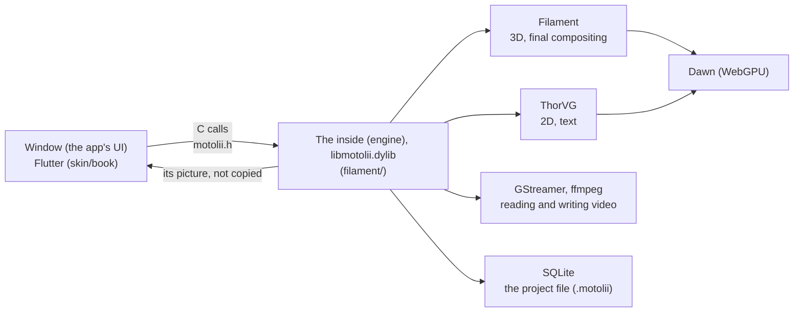

# Motolii

**Use a cool look you found on the net in your own video, right away — without waiting for a developer.**

Motolii is a macOS app for making music videos (picture-led motion graphics). Shader effects that people share online (ISF, WGSL) and AviUtl2 scripts work in your video **by dropping the file in**. 2D and 3D share one scene.

- **Stage**: under development (this repository since 2026-10-12; the earlier take, [rust_ae](https://github.com/oshikaidesu/rust_ae), since July; one author). There is no release yet; you build it from source.
- **Try it now if** you have an Apple silicon Mac, can paste commands into a terminal, and want to put shared shader effects or AviUtl2 scripts into a video.
- **Wait if** you need it for everyday work, use Windows, or want an app you just install.

[日本語](README.md) · [Questions (Discussions)](https://github.com/oshikaidesu/motolii/discussions) · [Bugs (Issues)](https://github.com/oshikaidesu/motolii/issues) — English or Japanese.

| 8 seconds made with Motolii (text, 3D, effects) | The window |
|---|---|
|  |  |

*The 8 seconds on the left: a recipe (the lines), a 3D ring, text, a glow and an RGB split, written out. How: [`docs/examples/mv.txt`](docs/examples/mv.txt), run the same way as "Your first piece (commands)" below.*


*Eight ISF effects as their authors share them (CMYK Halftone, Bad TV, Duotone, Edges, Dither-Bayer, Kaleidoscope Tile, Glow-Fast, Pixellate) on a public-domain photo and text.*

## What it does today

| You can drop in | What it is | State |
|---|---|---|
| ISF effects (`.fs`) | Shader effects for the picture, shared by VJ tools ([ISF-Files](https://github.com/Vidvox/ISF-Files) and others) | Put one in the effects folder and it is on the shelf. 318 of ISF-Files' 327 run (`filament/check/all.sh` counts them). 115 bundled |
| WGSL effects (`.wgsl`) | WebGPU shaders, e.g. three.js screen effects moved over | On the whole picture. 18 bundled |
| AviUtl2 scripts (`.anm2`, `.obj2`) | Effects for AviUtl2, a Japanese video editor; their HLSL is turned into WGSL | 172 packages bundled; the ones needing no Windows DLL first, partly |
| TSL (three.js shading language) | 48 TSL collections on the net, made WGSL by three.js's own compiler | Up to WGSL; not on the editor's shelves yet |
| Video, photos, text, shapes, glTF models, point clouds (`.ply`) | Media | Works (video: GStreamer, text and shapes: ThorVG, 3D: Filament) |
| After Effects exports (Lottie `.json`) | Animated pictures | Works (ThorVG) |
| MIDI (`.mid`) | Notes as parts of the scene: a piano roll, or keys set on values at each note | Works; it does not play sound yet |
| Your own scripts (`.js`) | Recipes that make a picture in one step, motions for things | Put one in and it is on the shelf. 44 recipes bundled |

Also: keyframes and easing (anime.js eases work as they are), physics (Jolt), refracting glass, writing mp4. Everything that exists and how far it was checked is in the author's ledger [`ASSETS.md`](ASSETS.md) (Japanese).

## How it differs

| | Motolii | After Effects | Cavalry | Alight Motion | Blender | VDMX, TouchDesigner | Motion Canvas, Rive |
|---|---|---|---|---|---|---|---|
| Adding a new look | Drop in a shared file (ISF, WGSL, AviUtl2, JS) | Buy or write a plugin | Build it yourself | Wait for an app update | Nodes or Python | ISF (VDMX) or GLSL you wire up | Write code, or make it in an editor |
| Made for | Making and writing out MV footage | Compositing | 2D motion graphics | Video on a phone | 3D | Live visuals (performing) | Video in code (Motion Canvas), animation inside apps (Rive) |
| 2D and 3D | One scene (Filament) | 2D and 3D layers | Mostly 2D | Mostly 2D | Mostly 3D | Both (as you wire it) | 2D |
| Runs on | macOS (Apple silicon) only | Windows, macOS | Windows, macOS | iOS, Android | Windows, macOS, Linux | VDMX: macOS; TouchDesigner: Windows, macOS | Browser and others |
| Maturity | Two weeks in this repository, one author, no release | Long established | Product | Product | Long established | Products | In use |
| Price, licence | Free, Apache-2.0 or MIT | Paid | Paid (free tier) | Paid (free tier) | Free, GPL | Paid (free tier) | Motion Canvas free, MIT; Rive has a free tier |

**Where Motolii is behind**: stability and breadth of features as a finished tool (every tool above is ahead), no app to hand out, no Windows, and no thought yet for performing live.

## How it is built



The window only takes your hands; the inside draws. The inside's folder is named `filament/` for historical reasons — it is Motolii's engine, not Google's Filament (which is fetched at build time). More in [`ARCHITECTURE.md`](ARCHITECTURE.md): entry points, how shared effects become WGSL, and a table from this repository's words to the usual ones.

## Where it stands

- Works: everything marked "Works" above, saving and undo, playback, writing mp4, the window's timeline, inspector and shelves.
- Partly: AviUtl2 scripts; copying Alight Motion's handling (of 649 operations in the reference table, 14% behave the same and 63% are missing: [`reports/overview.md`](reports/overview.md)).
- Known bug: a screen effect (`.wgsl`) put on a recipe made of copies (Iris, Weave, …) as that thing's effect breaks the picture; on the whole stage it is fine.
- Not yet: Windows; an `.app` you can hand out (the inside loads Homebrew's libraries, so a build only runs on the Mac that made it); some sound while working.

## Try it

### What you need

| | Version, size | Get it |
|---|---|---|
| Mac | Apple silicon (checked on macOS 15.5) | — |
| Xcode | Xcode from the App Store (the Command Line Tools alone cannot build the window); about 5 GB and up installed, by version | App Store; open it once to add its components, then `sudo xcodebuild -license accept` |
| Homebrew | — | The one line on [brew.sh](https://brew.sh/) |
| Flutter | 3.47.2 (stable) | [flutter.dev, macOS](https://docs.flutter.dev/get-started/install/macos); then `flutter doctor` should tick Xcode and macOS |
| Disk | About 10 GB (8.1 GB once built; Xcode and Flutter apart) | — |
| Downloads | About 1 GB (Filament's source 635 MB, Skia 65 MB, Jolt 16 MB and others; Homebrew's apart) | — |
| Time | About 10 minutes the first time on an M4 (Filament ~5, the inside ~1–2, the window ~1–3), plus downloads | — |

### Build and open

Paste one at a time. From the second on, run them inside the `motolii` folder (after `cd motolii`).

```bash
git clone https://github.com/oshikaidesu/motolii.git
```

```bash
cd motolii
```

```bash
brew bundle
```

Installs what the `Brewfile` lists (GStreamer, SQLite, ffmpeg, cmake, …). `Homebrew Bundle complete!` at the end means it worked.

```bash
filament/dawn_probe/build.sh
```

Fetches and builds Filament with its WebGPU backend (~5 minutes on an M4). A last line `dawn_probe: 4096 triangles …` with numbers means it worked.

```bash
filament/edit.sh build.motolii < /dev/null
```

Builds the inside, fetching ThorVG, Skia, libtess2 and Jolt the first time. `edit.sh` opens a document and waits for calls; `< /dev/null` gives it none, so it builds, makes an empty document and ends. `filament/out/libmotolii.dylib` existing means it worked (`build.motolii` can be deleted).

```bash
skin/book/live.sh
```

Opens the window. Closing the window ends it.

### Your first piece (in the window)


1. In the row of buttons at the top left, press the 5th (a square with a plus, **Create**) and type `Iris` in the search box.
2. Press the **Iris** tile, then **Create** at the bottom. A ring of colours appears on the stage and a band in the timeline.
   
3. With the ring picked, press the 2nd button (a sparkle, **Effects**), find `Glow`, press it, then **Add** at the bottom. The ring glows.
   
4. Press **Render** at the top right, type a name (e.g. `first`) and press **Render** again. `first.mp4` is written beside the document and the top bar says `Written: first.mp4`.
   

These steps also run as a test (`skin/book/integration_test/first_piece_test.dart`, which took the pictures above; for step 4 the test calls the same writing without the Render dialog).

### Your first piece (commands)

A recipe makes a picture, a glow goes on it, an RGB split (`rgbshift.wgsl`) goes on the whole picture, and 8 seconds are written as mp4. `filament/edit.sh` opens a document and takes one call per line (`help` lists them).

```bash
filament/edit.sh $HOME/Movies/first.motolii <<EOF
make Weave
effect 1 Glow
say 0 script $PWD/filament/effects/rgbshift.wgsl
write $HOME/Movies/first.mp4
EOF
```


`make` makes thing 1 from a recipe (`recipes` lists them); `effect` puts an effect on it (`effects` lists them); `say 0 script` puts a whole-picture effect on thing 0, the stage itself; `write` writes `first.mp4` into `Movies`.

### Reading the window

- Left: media and shelves (Create: recipes, shapes, text; Effects).
- Middle: the stage (the inside's own picture); below it the timeline (a band per thing, its keys) and Ease (how values move between keys).
- Right: the inspector (the picked thing's values; drag across a number to change it). Render, top right, writes the video.
- Your own effects and recipes go in `~/Library/Application Support/Motolii/` (`effects/`, `recipes/`, `ways/`) and appear on the shelves at once.

### If something stops

| You see | Do |
|---|---|
| `flutter: command not found` | Put Flutter on your PATH (flutter.dev), or `FLUTTER=/path/to/flutter skin/book/live.sh` |
| `brew: command not found` | Install Homebrew with the one line on [brew.sh](https://brew.sh/) |
| `xcrun: error`, or Xcode missing | Install Xcode from the App Store, open it once to add its components, then `sudo xcodebuild -license accept` |
| `No space left on device` | Free 10 GB or more, then run the command that stopped again |
| `git clone` or `build.sh` stopped on the network | Run the same command again; if it still stops, delete the half-fetched folder in `filament/third_party/` and run it again |
| `ld: library 'webgpu_dawn' not found` | Run `filament/dawn_probe/build.sh` first |
| The window opens but the stage is black | Check the inside is built (`filament/out/libmotolii.dylib`); if not, `filament/edit.sh build.motolii < /dev/null` |

Still stuck? Open an [issue](https://github.com/oshikaidesu/motolii/issues) with the command you ran and what it printed (there is a template). Questions about using it go to [Discussions](https://github.com/oshikaidesu/motolii/discussions). English or Japanese.

### Updating and removing

- Update: `git pull`, then run `filament/dawn_probe/build.sh` and `filament/edit.sh build.motolii < /dev/null` again (only what changed is rebuilt); `skin/book/live.sh` rebuilds the window.
- Remove: delete the `motolii` folder (everything fetched and built is inside it). Your documents and written videos stay where you put them. What `brew bundle` installed goes with `brew uninstall`.

## Contributing

See [`CONTRIBUTING.en.md`](CONTRIBUTING.en.md) (building, running the checks, the rules, good first tasks), the [Code of Conduct](CODE_OF_CONDUCT.md) and [`SECURITY.md`](SECURITY.md). Issues and pull requests in English are welcome.

The project's stance: **code you write yourself is a debt.** Look for an existing implementation first and use it the way its author meant; bundle other people's work as unchanged as possible, with their licence and source beside it; keep changes to upstream code as patches applied at build time; say in each commit what was borrowed from where. A lot of Motolii is still its own code today (the Flutter window, for one); where something can be borrowed instead, the own code goes.

| Folder | What |
|---|---|
| `filament/` | The inside (engine); its entry points and the files the current build uses: [`filament/README.md`](filament/README.md) |
| `filament/effects/`, `recipes/`, `animators/`, `ways/` | Bundled effects, recipes, motions and eases (the same shape as your own folder) |
| `filament/aviutl_scripts/` | Bundled AviUtl2 scripts (per author, with LICENSE and SOURCE.txt) |
| `filament/check/` | The inside's checks (`all.sh` runs them) |
| `skin/book/` | The window (Flutter, macOS); tests in `test/` and `integration_test/` |
| `thorvg/`, `old/` | Earlier work, kept |
| `docs/` | This README's pictures and examples (`media/`, `examples/`) and the author's working notes (`notes/`, Japanese) |

## Licence

Licensed under either of [Apache License 2.0](LICENSE-APACHE) or [MIT](LICENSE-MIT), at your option. Unless you explicitly state otherwise, any contribution intentionally submitted for inclusion in the work by you, as defined in the Apache-2.0 license, shall be dual licensed as above, without any additional terms or conditions. Bundled third-party works keep their own licences ([`THIRD_PARTY_NOTICES.md`](THIRD_PARTY_NOTICES.md)).
