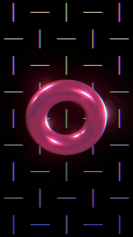
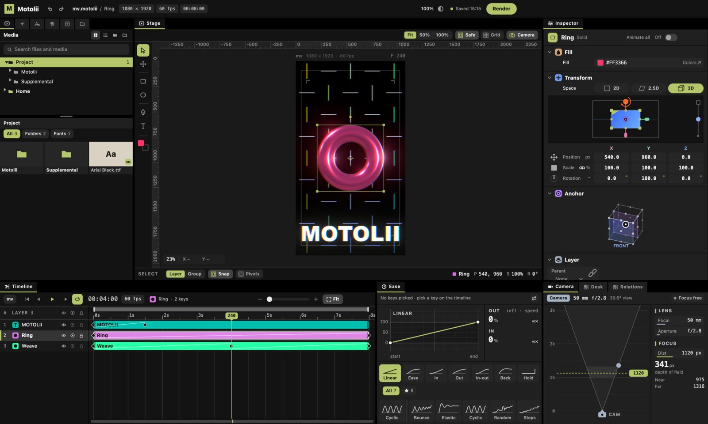
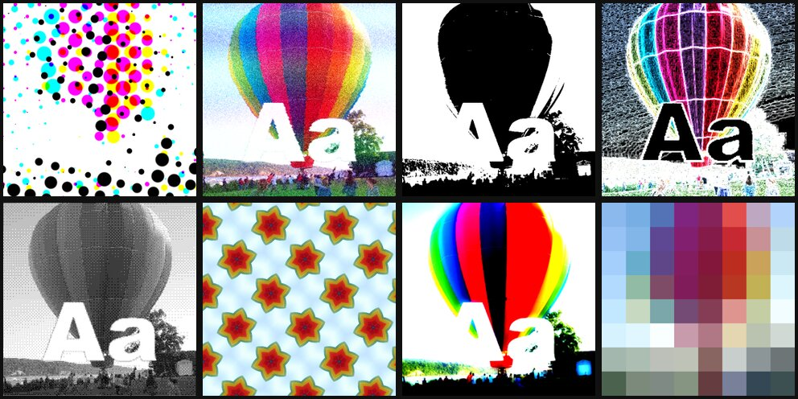
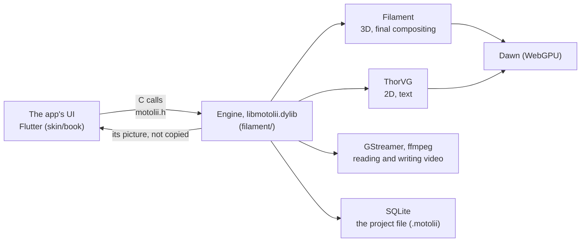
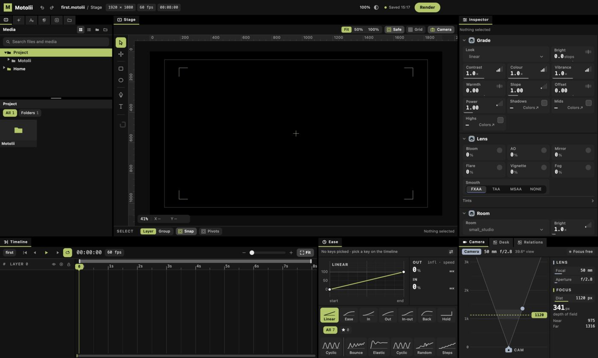
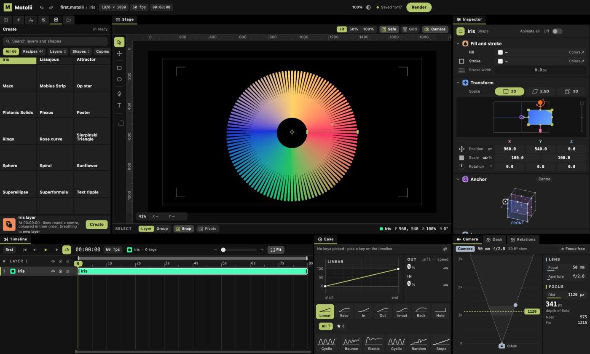
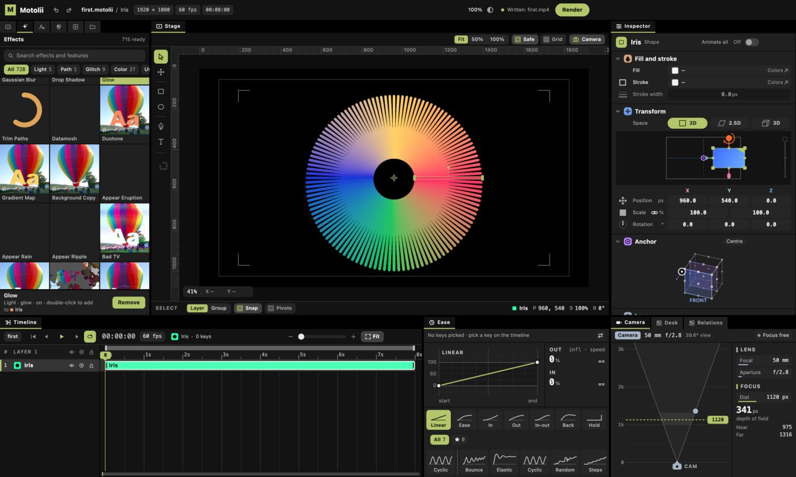
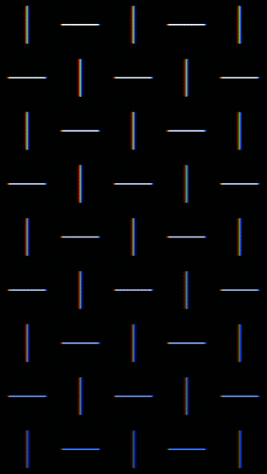

# Motolii

**Use a cool look you found on the net in your own video, right away — without waiting for a developer.**

Motolii is a macOS app for making music videos (picture-led motion graphics). Shader effects that people share online (ISF, WGSL) and AviUtl2 scripts work in your video **by dropping the file in**. 2D and 3D share one composition.

- **Stage**: under development, one author. This repository began on 2026-10-12 by copying the ThorVG and Filament experiments of the earlier take, [rust_ae](https://github.com/oshikaidesu/rust_ae) (since July), and rebuilt the drawing here; the UI (Flutter) came from a separate workshop. There is no release yet; you build it from source.
- **Try it now if** you have an Apple silicon Mac, can paste commands into a terminal, and want to put shared shader effects or AviUtl2 scripts into a video.
- **Wait if** you need it for everyday work, use Windows, or want an app you just install.

[日本語](README.md) · [Questions (Discussions)](https://github.com/oshikaidesu/motolii/discussions) · [Bugs (Issues)](https://github.com/oshikaidesu/motolii/issues) — English or Japanese.

**Words in the code and the Japanese docs**: window = the app's UI, the inside = the engine, thing = layer, stage = composition, document = project file (`.motolii`), shelf = the list of effects or recipes.

| 8 seconds made with Motolii (text, 3D, effects) | The app, with those 8 seconds open |
|---|---|
|  |  |

*The 8 seconds on the left: a recipe (the lines), a 3D ring, text, a glow and an RGB split, written out. Once built, `docs/examples/mv.sh` makes the same as `~/Movies/Motolii/mv.mp4` in one line.*



*Eight ISF effects as their authors share them (CMYK Halftone, Bad TV, Duotone, Edges, Dither-Bayer, Kaleidoscope Tile, Glow-Fast, Pixellate) on a public-domain photo and text.*

## What it does today

| You can | With | State |
|---|---|---|
| Put picture effects shared by VJ tools on your video | ISF (`.fs`, [ISF-Files](https://github.com/Vidvox/ISF-Files) and others) | Put one in the effects folder and it is on the shelf. 318 of ISF-Files' 327 run (`filament/check/all.sh` counts them again). 115 bundled |
| Put WebGPU shader effects on it | WGSL (`.wgsl`, e.g. three.js screen effects moved over) | On the whole composition. 18 bundled |
| Use effects made for AviUtl2, a Japanese video editor | `.anm2`, `.obj2` (their HLSL turned into WGSL) | 172 packages bundled. Counted on 10/26: 372 of the 594 scripts bundled then ran to the end ([`reports/aviutl2/catalogue.md`](reports/aviutl2/catalogue.md)). Ones that need a Windows DLL, not yet |
| Place video, photos, text, shapes, 3D models, point clouds | Video (GStreamer), text and shapes (ThorVG), glTF and `.ply` (Filament) | Works |
| Place After Effects animations | Lottie `.json` (ThorVG) | Works |
| Use notes as parts of the composition | MIDI (`.mid`): a piano roll, or keys set on values at each note | Works; MIDI is not heard yet (a video's sound is) |
| Make a picture in one step, or give a layer a motion | Your own scripts (`.js`) | Put one in and it is on the shelf. 44 recipes bundled |
| Looks written in TSL (three.js's shading language) | three.js's own compiler to WGSL | Up to WGSL; not on the shelves yet |

Also: keyframes and easing (anime.js eases work as they are), physics (Jolt), refracting glass, writing mp4. Everything that exists and how far it was checked is in the author's ledger [`ASSETS.md`](ASSETS.md) (Japanese).

**Speed** (M4, the 8-second example above, 1080×1920): about 4 ms a frame, no frame dropped even at 240 a second; writing the 8 seconds takes about 5 seconds, ffmpeg's encoding included.

## How it differs

| | Motolii | After Effects | Cavalry | Alight Motion | Blender | VDMX, TouchDesigner | Motion Canvas, Rive |
|---|---|---|---|---|---|---|---|
| Adding a new look | Drop in a shared file (ISF, WGSL, AviUtl2, JS) | Buy or write a plugin | Build it yourself | Wait for an app update | Nodes or Python | ISF (VDMX) or GLSL you wire up | Write code, or make it in an editor |
| Made for | Making and writing out MV footage | Compositing | 2D motion graphics | Video on a phone | 3D | Live visuals (performing) | Video in code (Motion Canvas), animation inside apps (Rive) |
| 2D and 3D | One composition (Filament) | 2D and 3D layers | Mostly 2D | Mostly 2D | Mostly 3D | Both (as you wire it) | 2D |
| Runs on | macOS (Apple silicon) only | Windows, macOS | Windows, macOS | iOS, Android | Windows, macOS, Linux | VDMX: macOS; TouchDesigner: Windows, macOS | Browser and others |
| Maturity | Two weeks in this repository, one author, no release | Long established | Product | Product | Long established | Products | In use |
| Price, licence | Free, Apache-2.0 or MIT | Paid | Paid (free tier) | Paid (free tier) | Free, GPL | Paid (free tier) | Motion Canvas free, MIT; Rive has a free tier |

**Where Motolii is behind**: stability and breadth of features as a finished tool (every tool above is ahead), no app to hand out, no Windows, and no thought yet for performing live.

**Why Alight Motion is the model for its handling**: people who make MVs on their phones already know how it feels; Motolii copies all of it first, then goes further. Of the 649 operations in the reference table, 14% behave the same today and 63% are missing ([`reports/overview.md`](reports/overview.md)).

## How it is built



The UI only takes your hands; the engine draws. The engine's folder is named `filament/` for historical reasons — it is Motolii's engine, not Google's Filament (which is fetched at build time). At its top level sit the 63 files the current build uses beside earlier probes (which still run with their own scripts): [`filament/README.md`](filament/README.md) says which is which, and [`ARCHITECTURE.md`](ARCHITECTURE.md) has the whole design.

## Where it stands

- Works: everything marked "Works" above, saving (automatic) and undo, playback (a video's sound is heard), writing mp4, the UI's timeline, value panel and shelves.
- Partly: AviUtl2 scripts; copying Alight Motion's handling (the 14% above).
- Known bug: a screen effect (`.wgsl`) put on a recipe made of copies (Iris, Weave, …) as that layer's effect breaks the picture; on the whole composition it is fine.
- Not yet: Windows; an `.app` you can hand out (the engine loads Homebrew's libraries, so a build only runs on the Mac that made it); MIDI sound.

## Try it

### What you need

| | Version, size | Get it |
|---|---|---|
| Mac | Apple silicon (checked on an M4, macOS 15.5) | — |
| Xcode | Xcode from the App Store (the Command Line Tools alone cannot build the UI); it can take more than 10 GB and 30 minutes to an hour to download | App Store; open it once to add its components, then `sudo xcodebuild -license accept` |
| Homebrew | — | The one line on [brew.sh](https://brew.sh/) |
| Flutter | 3.47.2 (stable), about 2 GB | "Get Flutter" below |
| Disk | About 10 GB besides Xcode and Flutter (8.1 GB once built) | — |
| Downloads | About 1 GB (Filament's source 635 MB, Skia 65 MB, Jolt 16 MB and others; Homebrew's apart) | — |
| Time | 1–2 hours from nothing, Xcode and Flutter included (depends on your connection); with them, about 10 minutes the first time on an M4 (Filament ~5, the engine ~1–2, the UI ~1–3) | — |

Homebrew versions it was checked with: GStreamer 1.28.8, SQLite 3.53.4, LuaJIT 2.1, QuickJS-ng 0.17.0, ffmpeg 9.0, cmake 4.1, ninja 1.13, meson 1.12.

### Get Flutter

```bash
git clone --depth 1 --branch 3.47.2 https://github.com/flutter/flutter.git ~/flutter
```

```bash
echo 'export PATH="$HOME/flutter/bin:$PATH"' >> ~/.zprofile && source ~/.zprofile
```

```bash
flutter doctor
```

Ticks on the `Xcode` and `macOS` lines mean it worked (crosses on Android or Chrome are fine). With FVM, `skin/book/.fvmrc` names the version.

### Build and open

Paste one at a time. From the second on, run them inside the `motolii` folder (after `cd motolii`).

```bash
git clone https://github.com/oshikaidesu/motolii.git
```

```bash
cd motolii
```

```bash
brew bundle
```

Installs what the `Brewfile` lists (GStreamer, SQLite, ffmpeg, cmake, …). `Homebrew Bundle complete!` at the end means it worked.

```bash
filament/dawn_probe/build.sh
```

Fetches and builds Filament with its WebGPU backend (~5 minutes on an M4). A last line `dawn_probe: 4096 triangles …` with numbers means it worked.

```bash
filament/edit.sh build.motolii < /dev/null
```

Builds the engine, fetching ThorVG, Skia, libtess2 and Jolt the first time. `edit.sh` opens a project file and waits for calls; `< /dev/null` gives it none, so it builds, makes an empty file and ends. `filament/out/libmotolii.dylib` existing means it worked (`build.motolii` can be deleted).

```bash
skin/book/live.sh
```

Opens the app. The project file is `~/Movies/Motolii/Untitled.motolii` (saved by itself), and written videos go beside it. Closing the window ends it; next time this one line opens it.

### Your first piece (in the app)



1. In the row of buttons at the top left, press the 5th (a square with a plus, **Create**) and type `Iris` in the search box.
2. Press the **Iris** tile, then **Create** at the bottom. A ring of colours appears and a band in the timeline.
   
3. With the ring picked, press the 2nd button (a sparkle, **Effects**), find `Glow`, press it, then **Add** at the bottom. The ring glows and the button turns into **Remove**.
   
4. Press **Render** at the top right; the Render box opens. Type a name (e.g. `first`) and press the box's **Render**.
   
5. `first.mp4` is written beside the project and the top bar says `Written: first.mp4`.
   

These five steps also run as a test (`skin/book/integration_test/first_piece_test.dart`, which took the pictures above).

### Next: your own media

- **Video and photos**: the 1st button (**Media**), open your folder from `Home`, pick a file and press **Place** at the bottom. A video's sound is heard while playing and goes into what you write.
- **Text**: pick **T** in the tools left of the composition and press on it; a text layer appears. Change its words in the text box of the value panel on the right. Fonts are on the 3rd button's shelf (**Aa**).
- **Motion**: turn on **Animate all** in the value panel, then drag a value (position, size, …) across; a key is set at the current time. Move the time and drag again, and it moves in between. Choose how it moves in **Ease** below.
- **Save and open**: saving is automatic (`Saved` and the time at the top). A new project: **File › New Document** (⌘N); another project in the same folder: **File › Open**.

### Your first piece (commands)

A recipe makes a picture, a glow goes on it, an RGB split (`rgbshift.wgsl`) goes on the whole composition, and 8 seconds are written as mp4. `filament/edit.sh` opens a project file and takes one call per line (`help` lists them).

```bash
filament/edit.sh $HOME/Movies/Motolii/first.motolii <<EOF
make Weave
effect 1 Glow
say 0 script $PWD/filament/effects/rgbshift.wgsl
write $HOME/Movies/Motolii/first.mp4
EOF
```



`make` makes layer 1 from a recipe (`recipes` lists them); `effect` puts an effect on it (`effects` lists them); `say 0 script` puts an effect on 0, the composition itself; `write` writes the mp4. The 8-second example at the top is `docs/examples/mv.sh` (its calls are in `docs/examples/mv.txt`).

### If something stops

| You see | Do |
|---|---|
| `flutter: command not found` | Run the second line of "Get Flutter" again, or `FLUTTER=/path/to/flutter skin/book/live.sh` |
| `brew: command not found` | Install Homebrew with the one line on [brew.sh](https://brew.sh/) |
| `xcrun: error`, or Xcode missing | Install Xcode from the App Store, open it once to add its components, then `sudo xcodebuild -license accept` |
| `No space left on device` | Free 10 GB or more, then run the command that stopped again |
| `git clone` or `build.sh` stopped on the network | Run the same command again; if it still stops, delete the half-fetched folder in `filament/third_party/` and run it again |
| `ld: library 'webgpu_dawn' not found` | Run `filament/dawn_probe/build.sh` first |
| The app opens but the composition is black | Check the engine is built (`filament/out/libmotolii.dylib`); if not, `filament/edit.sh build.motolii < /dev/null` |

Still stuck? Open an [issue](https://github.com/oshikaidesu/motolii/issues) with the command you ran and what it printed (there is a template). Questions about using it go to [Discussions](https://github.com/oshikaidesu/motolii/discussions). English or Japanese.

### Updating and removing

- Update: `git pull`, then run `filament/dawn_probe/build.sh` and `filament/edit.sh build.motolii < /dev/null` again (only what changed is rebuilt); `skin/book/live.sh` rebuilds the app.
- Remove: delete the `motolii` folder (everything fetched and built is inside it). Your projects and videos stay in `~/Movies/Motolii/` (or wherever else you put them). Flutter: delete `~/flutter`. What `brew bundle` installed goes with `brew uninstall`.

## Contributing

See [`CONTRIBUTING.en.md`](CONTRIBUTING.en.md) (building, running the checks, the rules, good first tasks), the [Code of Conduct](CODE_OF_CONDUCT.md) and [`SECURITY.md`](SECURITY.md). Issues and pull requests in English are welcome.

The project's stance: **code you write yourself is a debt.** Look for an existing implementation first and use it the way its author meant; bundle other people's work as unchanged as possible, with their licence and source beside it; keep changes to upstream code as patches applied at build time; say in each commit what was borrowed from where. A lot of Motolii is still its own code today (the Flutter UI, for one); where something can be borrowed instead, the own code goes.

| Folder | What |
|---|---|
| `filament/` | The engine; its entry points and the files the current build uses: [`filament/README.md`](filament/README.md) |
| `filament/effects/`, `recipes/`, `animators/`, `ways/` | Bundled effects, recipes, motions and eases (the same shape as your own folder) |
| `filament/aviutl_scripts/` | Bundled AviUtl2 scripts (per author, with LICENSE and SOURCE.txt) |
| `filament/check/` | The engine's checks (`all.sh` runs them) |
| `skin/book/` | The UI (Flutter, macOS); tests in `test/` and `integration_test/` |
| `thorvg/`, `old/` | Earlier work, kept |
| `docs/` | This README's pictures and examples (`media/`, `examples/`) and the author's working notes (`notes/`, Japanese) |

## Licence

Licensed under either of [Apache License 2.0](LICENSE-APACHE) or [MIT](LICENSE-MIT), at your option. Unless you explicitly state otherwise, any contribution intentionally submitted for inclusion in the work by you, as defined in the Apache-2.0 license, shall be dual licensed as above, without any additional terms or conditions. Bundled third-party works keep their own licences ([`THIRD_PARTY_NOTICES.md`](THIRD_PARTY_NOTICES.md)).
