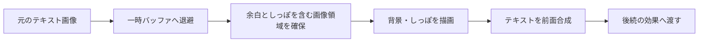

# 吹き出し背景@テキスト

無印PSDToolKitにあった「吹き出し@PSDToolKit」に相当するものです。普通のテキストにも使えます。

## 使い方

1. タイムラインへテキストオブジェクトを置きます。
2. テキストへアニメーション効果を追加します。
3. カテゴリ「NatuNeko」から「吹き出し背景@テキスト」を選びます。
4. `しっぽの向き`で`なし`、`上`、`下`、`左`、`右`を選びます。背景だけなら`なし`を選びます。
5. `しっぽの位置`で`割合`、`固定距離+`、`固定距離-`のいずれかを選び、余白、テキスト位置、色、背景の角丸、しっぽ角丸を調整します。

### 主な設定

| 設定 | 内容 | 初期値 |
|---|---|---:|
| 横余白 | 文字の左右に追加する余白 | 24 |
| 縦余白 | 文字の上下に追加する余白 | 16 |
| 背景色 | 背景としっぽの色 | `#202020` |
| 背景透明度 | 0が不透明、100が透明 | 20 |
| 角丸 | 背景四隅の丸み | 16 |
| オフセットX | 背景を固定したままテキストを左右へ移動 | 0 |
| オフセットY | 背景を固定したままテキストを上下へ移動 | 0 |
| しっぽの向き | なし / 上 / 下 / 左 / 右 | 下 |
| しっぽの位置 | `割合` / `固定距離+` / `固定距離-` | 割合 |
| 割合位置 | 辺の中央を0とする割合位置（-100～100%） | 50 |
| 固定距離 | 選択した基準端から付け根中心までの距離（0～2000px） | 50 |
| しっぽの幅 | 付け根の幅 | 72 |
| しっぽの高さ | 背景から標準先端までの長さ | 48 |
| しっぽ角丸 | しっぽ先端の丸み | 16 |
| 先端オフセットX | 標準先端から左右へ移動 | 0 |
| 先端オフセットY | 標準先端から上下へ移動 | 0 |

`割合`では従来どおり、辺の安全な可動範囲を-100～100%として付け根の中心を配置します。固定距離では0以上のピクセル距離を入力し、`しっぽの位置`の選択肢で基準端を切り替えます。

- `固定距離+`: 上・下のしっぽは左端、左・右のしっぽは上端から測ります。
- `固定距離-`: 上・下のしっぽは右端、左・右のしっぽは下端から測ります。

たとえば固定距離を80にした場合、`固定距離+`なら左端／上端から80px、`固定距離-`なら右端／下端から80pxです。吹き出しの大きさが変わっても、選択した端からの距離は変わりません。

Xは右、Yは下が正方向です。しっぽの先端オフセットは、`しっぽの高さ`で決まる標準先端からの相対値です。しっぽの幅または高さを0にすると、先端オフセットが設定されていてもしっぽは描画されません。

`しっぽ角丸`を1以上にすると、しっぽの先端に丸みが付きます。指定した先端位置は円弧の最外周として維持され、丸みはしっぽの幅と長さに合う範囲へ自動調整されます。`しっぽ角丸`が0の場合は尖った先端です。背景の`角丸`とは独立して調整できます。

角丸を大きくして辺の直線部分がなくなっても、しっぽは消えません。しっぽの位置を中央寄りへ制限し、付け根を丸い背景の内側まで自動的に重ねて表示します。

横余白、縦余白、テキストのオフセットX / Yは`-500～500`、背景の角丸としっぽ角丸は`0～500`です。余白を負にすると背景をテキストより小さくできます。極端な負の値は、背景が最低1ピクセル残る範囲へ自動制限されます。

### 基本例1: 字幕の背景

```text
横余白         24
縦余白         16
背景色         #202020
背景透明度     20
角丸           16
オフセットX    0
オフセットY    0
しっぽの向き   なし
```

白い字幕へ適用すると、少し透けた濃いグレーの角丸背景になります。

### 基本例2: セリフの吹き出し

```text
横余白           32
縦余白           20
背景色           #FFFFFF
背景透明度       0
角丸             20
オフセットX      0
オフセットY      -4
しっぽの向き     下
しっぽの位置     割合
割合位置         0
しっぽの幅       40
しっぽの高さ     28
しっぽ角丸       20
先端オフセットX 12
先端オフセットY 0
```

文字色を濃くすると、先端を少し右へ振った白い吹き出しになります。背景全体へ輪郭が必要な場合は、本効果より後へ標準の縁取り系効果を追加してください。

### 効果を置く順番

- 本効果より前の効果は、先にテキスト画像へ反映されます。本効果の背景は、その処理後の画像サイズを囲みます。
- 本効果より後の効果は、テキスト、背景、しっぽを合成した画像全体へ反映されます。

テキストだけをぼかして背景を鮮明に保ちたい場合は、`ぼかし`を本効果より前に置きます。背景もまとめてぼかしたい場合は、本効果より後に置きます。

## 導入方法

### 方法1: 配布パッケージ（推奨）

1. [GitHub Releases](https://github.com/natuneko722/TextBackgroundBalloonScript/releases)から、`TextBackgroundBalloonScript_v1.2.1.au2pkg.zip`をダウンロードします。
2. ZIPを展開せず、そのままAviUtl ExEdit2のプレビュー画面へドラッグ＆ドロップします。
3. 表示内容を確認してインストールします。

### 方法2: 手動配置

配布パッケージを展開し、次のファイルをコピーします。

```text
Script\NatuNeko\吹き出し背景@テキスト.anm2
  ↓
C:\ProgramData\aviutl2\Script\NatuNeko\吹き出し背景@テキスト.anm2
```

## v1.2.0以前から更新する場合

同じパッケージIDの`.au2pkg.zip`を使うため、既存版から更新できます。手動配置の場合は、先に新しい`NatuNeko`側へファイルを配置し、読み込めることを確認してから、該当する旧所有ファイルだけを削除してください。

```text
C:\ProgramData\aviutl2\Script\NNeko\吹き出し背景@テキスト.anm2
C:\ProgramData\aviutl2\Script\TextBackgroundBalloon\テキスト背景・吹き出し.anm2
```

`Script\NNeko`と`Script\NatuNeko`は他製品も使う共有フォルダーです。フォルダー全体は削除しないでください。

### 既存ユーザーのメニュー分類について

スクリプトと配布パッケージは`aviutl2.ini`を直接編集しません。今回の移行テストでは、旧ファイルを退避して新しい`NatuNeko`配置を登録すると、AviUtl2が対象効果のラベルを`NatuNeko`へ更新しました。

ユーザーが分類を変更している環境などでは保存済み設定が優先され、旧「NNeko」に残る可能性があります。その場合はAviUtl2の「設定」→「オブジェクト追加メニューの設定」を開き、対象のラベル欄を`NatuNeko`へ変更してください。INIの直接編集は不要です。

描画設定の項目順と正式名称はv1.2.0から変更していないため、既存プロジェクトの効果を配置変更だけを理由に付け直す必要はありません。ただし、新しいファイルパスは別の信頼確認対象になる場合があります。

## 削除方法

カタログまたは配布パッケージから導入した場合は、そのパッケージのアンインストール機能を使います。手動配置した場合は、AviUtl ExEdit2を終了してから次のファイルだけを削除してください。

```text
C:\ProgramData\aviutl2\Script\NatuNeko\吹き出し背景@テキスト.anm2
```

`Script\NatuNeko`と旧`Script\NNeko`は他のNatuNeko製スクリプトも使う共有フォルダーです。どちらもフォルダー全体は削除しないでください。

## 主な機能

- `しっぽの向き`を`なし`にして背景だけ、上・下・左・右にして吹き出しとして使用
- 1行・複数行のテキストサイズへ自動追従
- 負の値にも対応する横余白と縦余白
- テキストのオフセットX / Y
- 背景色、背景透明度、背景の角丸
- しっぽの上・下・左・右
- 割合、固定距離+、固定距離-で指定できるしっぽ位置
- しっぽの幅、高さ、しっぽ角丸、先端オフセットX / Y
- 最大画像サイズを超えない安全制限

## 対応環境と制約

- 対応: AviUtl ExEdit2 2.1.5以上
- 動作確認環境: AviUtl ExEdit2 2.1.5
- 旧AviUtl 1.x: 対象外
- テキスト以外へ適用した場合の見た目は保証しません。
- 縦書きと個別オブジェクトは保証対象外です。
- 割合位置と固定距離は、角丸へ不自然に食い込まない範囲を優先して自動的に制限されます。指定距離より角丸としっぽ半幅の合計が大きい場合や、直線部分が足りない場合は、安全な位置へ寄せられます。
- 画像上限ぎりぎりへ先端を移動した場合は、安全な出力領域を優先してしっぽ先端の丸みだけを無効化することがあります。
- 負の余白は背景を縮めますが、元テキストは出力領域から切れないよう保持されます。
- 画像上限へ近い大きなテキストでは、余白、オフセット、背景の角丸、しっぽ角丸、しっぽが安全な範囲へ制限または無効化される場合があります。
- 設定ヘッダーを変更した場合、「キャッシュを破棄」だけでは反映されないため、効果の付け直しまたはAviUtl ExEdit2の再起動が必要です。

## リリース情報

- バージョン: v1.2.1
- 状態: NatuNeko配置・分類への移行版
- 作者: natuneko722
- ライセンス: MIT License
- パッケージID: `natuneko722.text-background-balloon-script`

詳しい変更履歴は[RELEASE_NOTES.md](RELEASE_NOTES.md)をご覧ください。

## ライセンス

MIT Licenseです。詳細は[LICENSE](LICENSE)をご覧ください。

## 開発者向け情報

### リポジトリの構成

```text
├─ script/
│  └─ NatuNeko/
│     └─ 吹き出し背景@テキスト.anm2
├─ tests/
│  └─ quick_validate.py
├─ DEBUG_CHECKLIST.md
├─ LICENSE
├─ package.ini
├─ package.txt
├─ README.md
└─ RELEASE_NOTES.md
```

配布パッケージ内では、スクリプトを`Script\NatuNeko\吹き出し背景@テキスト.anm2`へ格納します。更新時に削除する旧ファイルは`Script\NNeko\吹き出し背景@テキスト.anm2`と、さらに古い`Script\TextBackgroundBalloon\テキスト背景・吹き出し.anm2`だけです。既存の`吹き出し字幕v001.anm2`などは上書きしません。

### 仕組み



外部DLLやスクリプトモジュールは使いません。埋め込みピクセルシェーダーで角丸としっぽを描画し、元テキストと1枚の画像へ合成します。

### 自動確認

Python 3が利用できる環境では、次を実行します。

```powershell
python -X utf8 tests\quick_validate.py
```

静的確認に加え、AviUtl2同梱Lua上で模擬オブジェクトを使った処理実行、領域計算、24定数、中心補正、HLSL Shader Model 5.0コンパイルを確認します。これはAviUtl ExEdit2実機テストの代わりではありません。

### 実機確認

具体的な順番と記録方法は[DEBUG_CHECKLIST.md](DEBUG_CHECKLIST.md)を参照してください。「NatuNeko」分類、新しい配置での信頼確認、旧所有ファイルだけが移行されていることも確認します。
